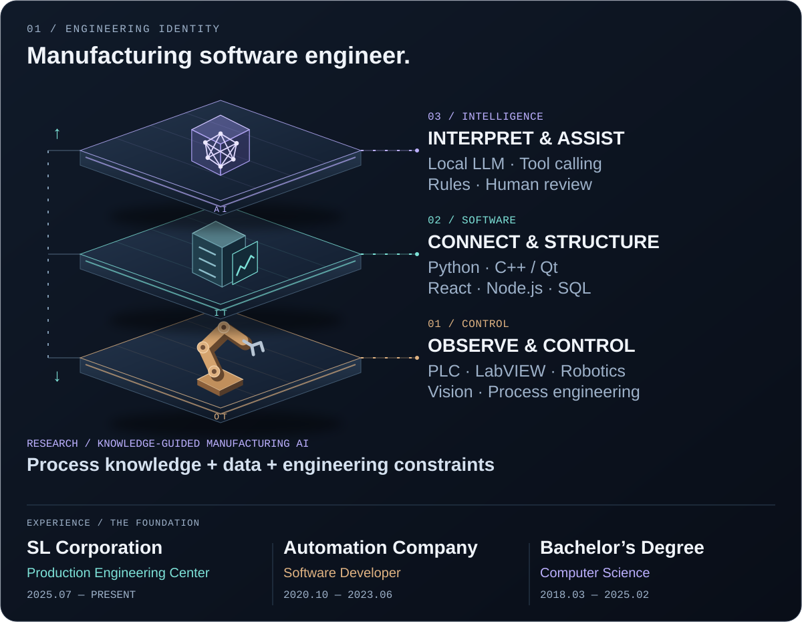

  <picture>
    <source media="(prefers-reduced-motion: reduce) and (max-width: 600px)" srcset="./assets/identity-mobile-static.svg" />
    <source media="(prefers-reduced-motion: reduce)" srcset="./assets/identity-static.svg" />
    <source media="(max-width: 600px)" srcset="./assets/identity-mobile.svg" />
    
  </picture>

  <picture>
    <source media="(prefers-reduced-motion: reduce) and (max-width: 600px)" srcset="./assets/architecture-mobile-static-268c4285ae1d.svg" />
    <source media="(prefers-reduced-motion: reduce)" srcset="./assets/architecture-static-c861cd4d4798.svg" />
    <source media="(max-width: 600px)" srcset="./assets/architecture-mobile-774d914f69b7.svg" />
    
  </picture>

  
  
  

