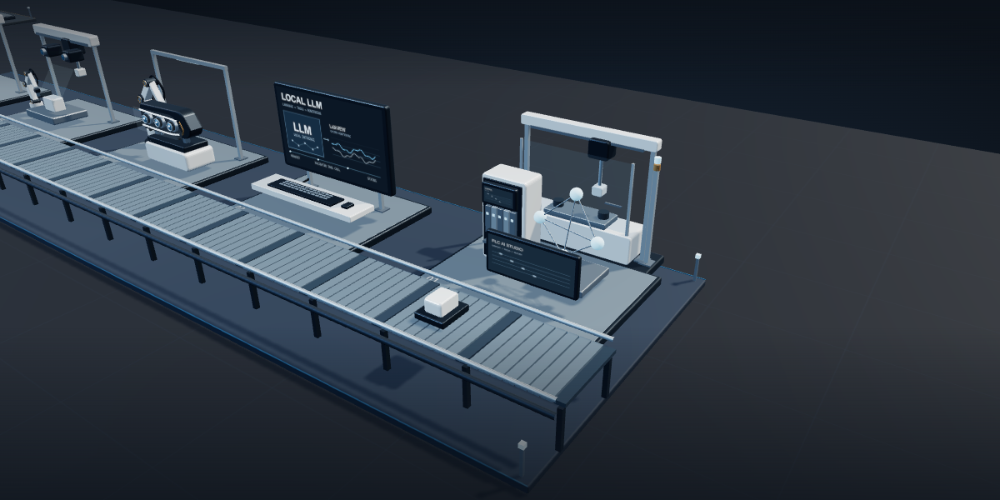

# Eonsang Son

Manufacturing Software Engineer

I build industrial software, automate equipment, and explore how AI can help on the factory floor.

<a href="https://fortex66.github.io/">
  <picture>
    <source media="(prefers-reduced-motion: reduce)" srcset="./assets/factory-road.png" />
    <source type="image/webp" srcset="./assets/factory-road.webp" />
    
  </picture>
</a>

## [Explore my 3D portfolio](https://fortex66.github.io/)

Projects, experience, and the story behind my work.

---

[Journal](https://fortex66.tistory.com/) · [Email](mailto:fortex66@naver.com)
