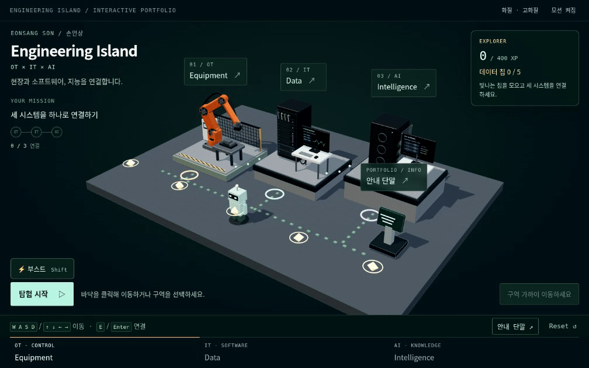

# 안녕하세요, 손언상입니다.

설비를 움직이는 제어부터 현장에서 쓰는 소프트웨어까지 만들어 왔습니다. 
요즘은 그 경험을 바탕으로, 제조 현장에 AI를 어떻게 쓸 수 있을지 고민하며 개발하고 있습니다.

### 제가 만든 것들이 궁금하다면

프로젝트와 경력은 작은 3D 공간에 모아 두었습니다. 직접 돌아다니며 살펴보세요.

## [포트폴리오 둘러보기 ↗](https://fortex66.github.io/)

<a href="https://fortex66.github.io/">
  <picture>
    <source media="(prefers-reduced-motion: reduce)" srcset="./assets/portfolio-preview.png" />
    
  </picture>
</a>

*위 화면을 누르면 포트폴리오로 이동합니다. 이동과 탐험은 사이트에서 할 수 있어요.*

---

**SL Corporation · Production Engineering Center** 
Jul. 2025 – Present

**Automation Company · Software Developer** 
Oct. 2020 – Jun. 2023

**Bachelor’s Degree · Computer Science** 
Mar. 2018 – Feb. 2025

[개발하며 남긴 글](https://fortex66.tistory.com/) · [이메일](mailto:fortex66@naver.com)
