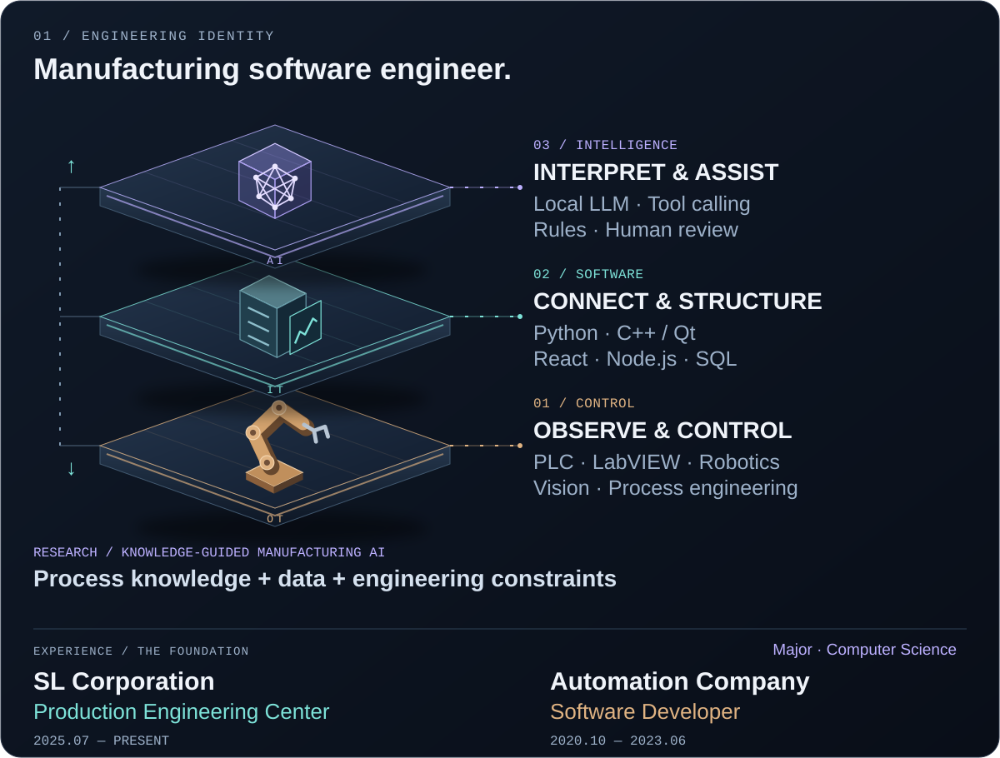

  <picture>
    <source media="(prefers-reduced-motion: reduce) and (max-width: 600px)" srcset="./assets/identity-mobile-static.svg" />
    <source media="(prefers-reduced-motion: reduce)" srcset="./assets/identity-static.svg" />
    <source media="(max-width: 600px)" srcset="./assets/identity-mobile.svg" />
    
  </picture>

  <picture>
    <source media="(prefers-reduced-motion: reduce) and (max-width: 600px)" srcset="./assets/architecture-mobile-static.svg" />
    <source media="(prefers-reduced-motion: reduce)" srcset="./assets/architecture-static.svg" />
    <source media="(max-width: 600px)" srcset="./assets/architecture-mobile.svg" />
    
  </picture>

  
  
  

  <picture>
    <source media="(max-width: 600px)" srcset="./assets/projects-mobile.svg" />
    
  </picture>

Text version & project links

**Identity:** Manufacturing software engineer — connecting industrial control, structured data, and AI-assisted decisions. 
**Current:** SL Corporation · Production Engineering Center (Jul. 2025–Present). 
**Previously:** Automation Company · Software Developer (Oct. 2020–Jun. 2023). 
**Major:** Computer Science.

- **PLC AI Studio** — AI-assisted PLC analysis & change review. In development; private repository.
- **[Local LLM × LabVIEW](https://github.com/fortex66/local-llm-field-monitoring-agent)** — Natural-language tools for existing systems.
- **Manufacturing Process Optimization** — 제조 공정 최적화 기술 — feedback-driven process improvement.
- **Vision & Robot Alignment** — Vision, robotics, and production integration.
- **G90 · GV90 Programs** — G90 · GV90 프로젝트 참여 — process engineering.
- **Industrial Embedded Controllers** — Industrial HMI and embedded control software.
- **[Water Treatment SCADA](https://github.com/fortex66/Water-Treatement-SCADA)** — Connected facilities and remote operation. Joint project with [seonghyeon0312](https://github.com/seonghyeon0312).
- **[ForTex-Viewer](https://github.com/fortex66/ForTex-Viewer)** — PLC-connected monitoring and visualization.
- **[EV Battery Management](https://github.com/fortex66/Lithium-Ion-Battery-Management-System)** — Sensor-based energy monitoring and control.
- **[JourneyMate](https://github.com/fortex66/JourneyMate)** — Travel information and real-time collaboration.
- **[SmartFarm](https://github.com/fortex66/SmartFarm)** — A trading platform for the smart-farm domain.

**Core stack:** PLC · LabVIEW · Robotics · Vision / Python · C++ / Qt · React · Node.js · SQL / Local LLM · Tool calling · Rule-based validation.

**Research interest:** Knowledge-guided manufacturing AI — process data and engineering constraints for human-centered decision support.

